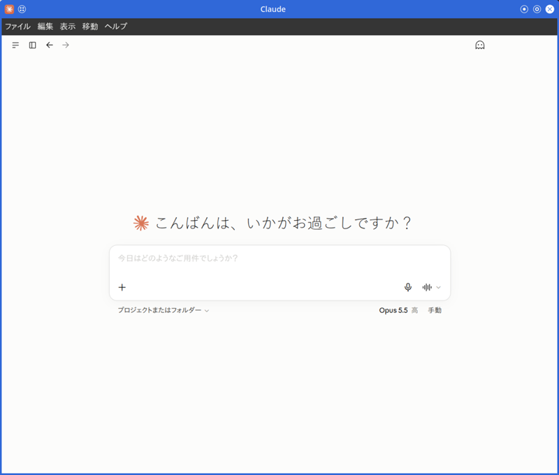
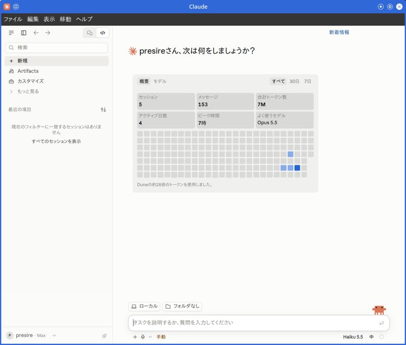

# Claude Desktop for openSUSE/SUSE Linux Enterprise

[](README.md#license)
[](README.md#distribution-support)
[](docs/BUILDING.md)

This project provides build scripts to run Claude Desktop natively on openSUSE and SUSE Linux Enterprise systems.  
It repackages the official Windows application, producing `.rpm` packages and distribution-agnostic AppImages.  

This is a fork of [aaddrick/claude-desktop-debian](https://github.com/aaddrick/claude-desktop-debian) adapted for openSUSE/SLE distributions.  

> [!NOTE]
> This is an unofficial build script. For official support, please visit [Anthropic's website](https://www.anthropic.com).  
> For issues with the build script or Linux implementation,  
> please [open an issue](https://github.com/presire/claude-desktop-suse/issues) in this repository.  

## Features

| Area | Feature | Details |
|:---|:---|:---|
| Core | Native Linux support | Runs Claude Desktop natively, without virtualization or Wine. |
| Core | In-app topbar | Adds a hamburger menu, sidebar toggle, search, and navigation through a Window Controls Overlay (WCO) shim in hybrid mode. |
| Core | Titlebar styles | Offers three modes:<br>hybrid (default, OS frame plus in-app topbar), native, and hidden. |
| Core | Window icon | Sets the Claude logo as the window icon, so X11 window managers such as KWin draw the app icon in the titlebar, `[Alt]-[Tab]` switcher, and taskbar instead of Electron's default atom glyph. |
| Core | Close-to-tray | Closing the window hides it to the tray and keeps MCP servers and schedulers running.<br>Set `CLAUDE_QUIT_ON_CLOSE=1` to quit the app outright instead. |
| Core | Run on startup | Provides XDG Autostart integration for the "Run on startup" settings toggle. |
| Core | In-place upgrade detection | When `zypper up` replaces `app.asar` while the app is running, Claude Desktop shows a "click to restart" notification.<br>This prevents v(N+1) HTML from running against v(N) IPC. |
| Core | KDE Plasma Wayland launcher grouping | Sets `pkg.desktopName` inside the packaged `app.asar`, so KDE Plasma groups Claude Desktop windows under the installed `.desktop` file.<br>This fixes ungrouped taskbar entries on Wayland. |
| Core | Tray icon theme switching | Uses a trailing-edge rebuild mutex and an in-place icon and context-menu update fast-path on `nativeTheme` changes.<br>This avoids the startup dark-icon latch and the KDE Plasma duplicate-SNI race when the theme changes. |
| Core | MCP support | Full Model Context Protocol integration.<br>Servers deleted in Settings stay deleted, and `mcpServers` survive a failed config load.<br>Edit `~/.config/Claude/claude_desktop_config.json` by hand only while the app is closed. |
| Core | Cowork mode | Pluggable isolation backends (bubblewrap or host) with auto-detection, daemon auto-respawn with cooldown, and a `{src, dst}` mount form for distinct host and sandbox paths.<br>Re-derived against the upstream "yukonSilver" VM refactor (Claude Desktop 1.13576+). |
| Core | Diagnostics | Built-in health check via `claude-desktop --doctor`, covering the display server, sandbox permissions, MCP config, stale locks, IBus/GTK input-method routing, Cowork backend readiness, keyring and password-store detection, the AppArmor user-namespace profile, `NAME_MAX` for encrypted home directories, and recent Electron crash history. |
| System integration | Global hotkey | `[Ctrl] + [Alt] + [Space]` works on X11 and on Wayland through XWayland.<br>The native Wayland route uses the XDG GlobalShortcuts portal. (`CLAUDE_USE_WAYLAND=1`) |
| System integration | System tray | Provides tray integration with close-to-tray persistence. |
| System integration | Desktop environment integration | Integrates Claude Desktop with the desktop environment. |
| System integration | Quick Window patches | Applies Quick Window blur and visibility patches on KDE only, which avoids GNOME regressions. |
| System integration | Keyring detection | Auto-detects the keyring (`--password-store`) for kwallet6 and gnome-libsecret. This fixes session persistence on KDE Plasma and other desktops where Electron's `safeStorage` was unavailable. |
| System integration | GPU crash auto-recovery | If a previous launch died with a Chromium GPU FATAL, the next launch automatically uses safe GPU flags. Override with `CLAUDE_DISABLE_GPU=0`. |
| System integration | AppStream metadata | Ships AppStream metainfo, so the package appears in GNOME Software and KDE Discover with its name, summary, icon, and branding. |
| System integration | Helper-process cleanup | Cleans up helper processes on an explicit quit, so Desktop-owned Cowork, Claude config, and extension helpers are not left running. |
| System integration | Launch-time reapers | Matches helpers by their argv shape, so an editor or `tail -f` that merely names `cowork-vm-service.js` is never killed.<br>They only reap extension servers started by an earlier launch, never send SIGKILL to a reused PID, and remove a `SingletonLock` only when its PID is dead. |
| System integration | Log management | De-duplicates Electron output in `launcher.log` and caps it per session with `ELECTRON_LOG_CAP_BYTES` (default 20[MiB]). |
| System integration | AppImage runtime | Builds the AppImage on the static type2 runtime with pinned, SHA-256-verified build tools.<br>`libfuse2` is not required. |
| System integration | Electron baseline | Built on Electron 44, the major shipped in the Windows package. On native Wayland, the AppImage writes a hidden desktop entry so xdg-desktop-portal 1.20 or later accepts its app id for the GlobalShortcuts portal. |
| Window behavior | Window chrome parity | Adds an F11 fullscreen toggle and an Alt-keyup-only menu bar trigger, so `[Alt] + [Shift]` and `[Alt] + [F4]` no longer toggle the menu bar by accident.<br>Also restores GNOME/X11 About-window rendering after upstream's `titleBarStyle` migration and suppresses X11 sloppy-focus raise-on-hover. |

### Screenshots

<p align="center">
  
</p>

<p align="center">
  
</p>

<p align="center">
  
</p>

<br>

## Installation

### Building from Source

See [docs/BUILDING.md](docs/BUILDING.md) for detailed build instructions, technical details, and manual update procedures.  

#### Prerequisites

Install the required packages before building:  

```bash
sudo zypper install git gcc-c++ make
```

> [!WARNING]  
> The build checks for `python3` as a build tool by default; on SUSE, missing dependencies are installed via `zypper`.  
> Python is not used to compile `node-pty`: terminal support is staged from a prebuilt Linux binary.  
> If no suitable native binary is available for the target architecture, the build fails instead of producing a package without terminal support.  
> See [docs/BUILDING.md](docs/BUILDING.md) for details.  

#### Build and Install

```bash
# Clone the repository
git clone https://github.com/presire/claude-desktop-suse.git
cd claude-desktop-suse

# Build an RPM package (default)
./build.sh

# Build an AppImage
./build.sh --build appimage

# Build with dark-mode tray icons (white icons for dark panels)
./build.sh --dark

# Install the package
sudo zypper install ./claude-desktop-VERSION-ARCHITECTURE.rpm
```

The build script automatically installs remaining dependencies (`p7zip`, `wget`, `icoutils`, `ImageMagick`, `rpm-build`) via zypper.  
See [Node.js and asar](docs/BUILDING.md#nodejs-and-asar) for the Node.js requirement and how the build provides it.  

### Using Pre-built Releases

Download the latest `.rpm` or `.AppImage` from the [Releases page](https://github.com/presire/claude-desktop-suse/releases).  

#### Importing the RPM signing key

Release `.rpm` packages are signed with GPG.  
Import the public key once, and zypper verifies the signature on every install. (the unsigned-package warning disappears)  

| Item | Value |
|:---|:---|
| Key file | [`gpg/RPM-GPG-KEY-Claude-Desktop-SUSE`](gpg/RPM-GPG-KEY-Claude-Desktop-SUSE)<br>(in the repository, also attached to each release) |
| UID | `claude-desktop-suse <presire@users.noreply.github.com>` |
| Fingerprint | `E699 6FE7 DC7A 9D08 5F8F 7D20 DA09 CAFB 07FA EC11` |

```bash
# 1. Download the public key
curl -LO https://raw.githubusercontent.com/presire/claude-desktop-suse/main/gpg/RPM-GPG-KEY-Claude-Desktop-SUSE

# 2. Check that the fingerprint matches the table above
gpg --show-keys RPM-GPG-KEY-Claude-Desktop-SUSE

# 3. Import the key into the RPM database (first time only)
sudo rpm --import RPM-GPG-KEY-Claude-Desktop-SUSE

# 4. Verify the package signature (optional; expect "digests signatures OK")
rpm -K ./claude-desktop-*.rpm

# 5. Install
sudo zypper install ./claude-desktop-*.rpm
```

To check the downloads against the checksums, verify `SHA256SUMS.txt` with its signature first:  

```bash
gpg --import RPM-GPG-KEY-Claude-Desktop-SUSE
gpg --verify SHA256SUMS.txt.asc SHA256SUMS.txt
sha256sum -c --ignore-missing SHA256SUMS.txt
```

To remove the key later: `sudo rpm -e gpg-pubkey-07faec11`  

<br>

## Configuration

Model Context Protocol settings are stored in:  

```
~/.config/Claude/claude_desktop_config.json
```

For additional configuration options including environment variables,  
Wayland support, and Cowork sandbox mounts, see [docs/CONFIGURATION.md](docs/CONFIGURATION.md).  

<br>

## Troubleshooting

Run `claude-desktop --doctor` for built-in diagnostics that check common issues.  
(display server, sandbox permissions, MCP config, stale locks, and more)  

It also reports cowork mode readiness - which isolation backend will be used, and which dependencies are installed or missing.  

For additional troubleshooting, uninstallation instructions, and log locations, see [docs/TROUBLESHOOTING.md](docs/TROUBLESHOOTING.md).  

<br>

## Distribution Support

### Tested Distributions

- openSUSE Leap 156+  
- openSUSE Tumbleweed  
- SUSE Linux Enterprise 16+  

<br>

## Acknowledgments

This fork is based on [aaddrick/claude-desktop-debian](https://github.com/aaddrick/claude-desktop-debian).  

The original project was inspired by [k3d3's claude-desktop-linux-flake](https://github.com/k3d3/claude-desktop-linux-flake) and their [Reddit post](https://www.reddit.com/r/ClaudeAI/comments/1hgsmpq/i_successfully_ran_claude_desktop_natively_on/) about running Claude Desktop natively on Linux.  

Special thanks to:  

- **aaddrick** for the original Debian build scripts
- **k3d3** for the original NixOS implementation and native bindings insights
- **[emsi](https://github.com/emsi/claude-desktop)** for the title bar fix and alternative implementation approach
- **[leobuskin](https://github.com/leobuskin/unofficial-claude-desktop-linux)** for the Playwright-based URL resolution approach
- **[yarikoptic](https://github.com/yarikoptic)** for codespell support and shellcheck compliance
- **[IamGianluca](https://github.com/IamGianluca)** for build dependency check improvements
- **[ing03201](https://github.com/ing03201)** for IBus/Fcitx5 input method support
- **[ajescudero](https://github.com/ajescudero)** for pinning @electron/asar for Node compatibility
- **[delorenj](https://github.com/delorenj)** for Wayland compatibility support
- **[Regen-forest](https://github.com/Regen-forest)** for suggesting Gear Lever as AppImageLauncher replacement
- **[niekvugteveen](https://github.com/niekvugteveen)** for fixing Debian packaging permissions
- **[speleoalex](https://github.com/speleoalex)** for native window decorations support
- **[imaginalnika](https://github.com/imaginalnika)** for moving logs to `~/.cache/`
- **[richardspicer](https://github.com/richardspicer)** for the menu bar visibility fix on Linux
- **[jacobfrantz1](https://github.com/jacobfrantz1)** for Claude Desktop code preview support and quick window submit fix
- **[janfrederik](https://github.com/janfrederik)** for the `--exe` flag to use a local installer
- **[MrEdwards007](https://github.com/MrEdwards007)** for discovering the OAuth token cache fix
- **[lizthegrey](https://github.com/lizthegrey)** for version update contributions
- **[mathys-lopinto](https://github.com/mathys-lopinto)** for the AUR package and automated deployment
- **[pkuijpers](https://github.com/pkuijpers)** for root cause analysis of the RPM repo GPG signing issue
- **[dlepold](https://github.com/dlepold)** for identifying the tray icon variable name bug with a working fix
- **[Voork1144](https://github.com/Voork1144)** for detailed analysis of the tray icon minifier bug, root-cause analysis of the Chromium layout cache bug, and the fix approach of resizing the direct child view
- **[sabiut](https://github.com/sabiut)** for the `--doctor` diagnostic command, SHA-256 checksum validation for downloads, and post-build integration tests for deb, rpm, and AppImage artifacts
- **[milog1994](https://github.com/milog1994)** for Linux UX improvements including popup detection, functional stubs, and Wayland compositor support
- **[jarrodcolburn](https://github.com/jarrodcolburn)** for passwordless sudo support in container/CI environments, identifying the gh-pages 4GB bloat fix, identifying the virtiofsd PATH detection issue on Debian, detailed analysis of the CI release pipeline failure, and diagnosing the session-start hook sudo blocking issue
- **[chukfinley](https://github.com/chukfinley)** for experimental Cowork mode support on Linux
- **[CyPack](https://github.com/CyPack)** for orphaned cowork daemon cleanup on startup
- **[IliyaBrook](https://github.com/IliyaBrook)** for fixing the platform patch for Claude Desktop >= 1.1.3541 arm64 refactor
- **[MichaelMKenny](https://github.com/MichaelMKenny)** for diagnosing the `$`-prefixed electron variable bug with root cause analysis and workaround
- **[daa25209](https://github.com/daa25209)** for detailed root cause analysis of the cowork platform gate crash and patch script
- **[noctuum](https://github.com/noctuum)** for the `CLAUDE_MENU_BAR` env var with configurable menu bar visibility and boolean alias support
- **[typedrat](https://github.com/typedrat)** for the NixOS flake integration with build.sh, node-pty derivation, CI auto-update, and fixing the flake package scoping regression
- **[cbonnissent](https://github.com/cbonnissent)** for reverse-engineering the Cowork VM guest RPC protocol, fixing the KVM startup blocker, fixing RPC response id echoing for persistent connections, and configurable bwrap mount points via a dedicated Linux config file
- **[joekale-pp](https://github.com/joekale-pp)** for adding `--doctor` support to the RPM launcher
- **[ecrevisseMiroir](https://github.com/ecrevisseMiroir)** for the bwrap backend sandbox isolation with tmpfs-based minimal root
- **[arauhala](https://github.com/arauhala)** for detailed root cause analysis of the NixOS `isPackaged` regression
- **[cromagnone](https://github.com/cromagnone)** for confirming the VM download loop on bwrap installs with detailed logs that disproved the initial triage
- **[aHk-coder](https://github.com/aHk-coder)** for diagnosing the hardcoded minified variable crash in the cowork smol-bin patch
- **[RayCharlizard](https://github.com/RayCharlizard)** for detailed analysis of the self-referential `.mcpb-cache` symlink ELOOP bug and fixing auto-memory path translation on HostBackend
- **[reinthal](https://github.com/reinthal)** for fixing the NixOS build breakage caused by the nixpkgs `nodePackages` removal
- **[gianluca-peri](https://github.com/gianluca-peri)** for reporting the GNOME quit accessibility issue and confirming tray behavior with AppIndicator
- **[martin152](https://github.com/martin152)** for detailed diagnosis and a complete patch for three launcher cleanup bugs: the orphaned cowork daemon cleanup matching itself, the stale cowork socket cleanup doing nothing without socat, and the same self-match in `--doctor`
- **[hfyeh](https://github.com/hfyeh)** for diagnosing the Ubuntu 24.04 AppArmor unprivileged-userns block on Cowork bwrap and contributing the AppArmor profile workaround
- **[davidamacey](https://github.com/davidamacey)** for identifying and fixing the XRDP GPU compositing blank-window issue on remote desktop sessions
- **[pb3ck](https://github.com/pb3ck)** for diagnosing the Cowork `CLAUDE_CODE_OAUTH_TOKEN` env-strip bug with a working reference diff
- **[aJV99](https://github.com/aJV99)** for exporting `GDK_BACKEND=wayland` in native Wayland mode to fix XWayland fallback blur on HiDPI displays
- **[Andrej730](https://github.com/Andrej730)** for the quick-window regex readability refactor (raw string literals + a regex-escaping helper) and fixing the visibility-function regex break on Claude Desktop 1.3883.0
- **[Joost-Maker](https://github.com/Joost-Maker)** for fixing the `$e` fs reference crash in cowork Patch 9 on Claude Desktop 1.3109.0 by introducing the `[$\w]+` identifier-capture pattern
- **[HumboldtJoker](https://github.com/HumboldtJoker)** for diagnosing the cowork Patch 2b silent failure on Claude Desktop 1.5354.0 - identifying that the log line was patched but session init still routed through the Swift addon
- **[zabka](https://github.com/zabka)** for identifying that `cowork-vm-service.js` was never auto-spawned on Linux and contributing a systemd-unit workaround that scoped the daemon auto-launch fix
- **[sirfaber](https://github.com/sirfaber)** for fixing the `$`-in-minified-identifier breakage of cowork Patch 2b (vm module assignment) and Patch 6 step 2 (retry-delay auto-launch) on Claude Desktop 1.5354.0
- **[ProfFlow](https://github.com/ProfFlow)** for re-fixing the RPM repodata signing regression by appending `!` to the keyid passed to `gpg --default-key`, forcing `repomd.xml` to be signed by the primary key
- **[jslatten](https://github.com/jslatten)** for fixing the KDE Plasma Wayland launcher-grouping bug by setting `pkg.desktopName` in the packaged `app.asar`'s `package.json`
- **[Hayao0819](https://github.com/Hayao0819)** for diagnosing the upstream `titleBarStyle:""` → `titleBarStyle:"hiddenInset"` migration that broke the About window render on GNOME/X11 and contributing the extended popup-window match
- **[phelps-matthew](https://github.com/phelps-matthew)** for fixing `CLAUDE_QUIT_ON_CLOSE=1` to actively quit the app instead of relying on the bundled handler that hardcodes hide-to-tray on Linux
- **[dubreal](https://github.com/dubreal)** for `--password-store` keyring detection that probes D-Bus for kwallet6 / gnome-libsecret at startup, fixing session persistence on KDE Plasma and other desktops where Electron's `safeStorage` was unavailable
- **[JustinJLeopard](https://github.com/JustinJLeopard)** for detecting missing electron binaries after Node 24's `extract-zip` silently no-ops, with an `unzip` fallback that recovers from the `@electron/get` cache; and for the AppStream metainfo that surfaces the package in GNOME Software, KDE Discover, and App Center
- **[tkrag](https://github.com/tkrag)** for diagnosing and fixing the X11 window-raise-on-hover bug under sloppy/focus-follows-mouse WMs
- **[maplefater](https://github.com/maplefater)** for re-anchoring the trusted-folder `.asar` guard on its method declaration after upstream folded the log call into a comma-expression
- **[MitchSchwartz](https://github.com/MitchSchwartz)** for finding the second `app.asar` file-drop path - the file-existence branch in the second-instance argv collector - and rejecting `.asar` paths there so the app no longer prompts to attach its own bundle on every taskbar reopen
- **[LiukScot](https://github.com/LiukScot)** for making the tray rebuild mutex trailing-edge so the startup dark-theme icon no longer latches black, and restoring the in-place tray icon update fast-path after upstream changed the context-menu wiring to a prebuilt menu object
- **[jerem](https://github.com/jerem)** for routing Quick Entry's global shortcut through the XDG GlobalShortcuts portal on native Wayland, and merging all Chromium feature requests into a single `--enable-features=` switch
- **[caidejager](https://github.com/caidejager)** for diagnosing why Cowork's VM daemon never auto-launched on packages built under a restrictive umask and normalizing install permissions across deb and AppImage
- **[DhanushSantosh](https://github.com/DhanushSantosh)** for the GPU crash auto-recovery in the launcher: detecting a previous GPU-process FATAL in the launcher log and re-launching with safe GPU flags automatically
- **[emandel82](https://github.com/emandel82)** for root-causing the "Attach app.asar?" prompt: every launcher passed `app.asar` as a redundant Electron argument, which the second-instance argv collector treated as a file to open
- **[svankirk](https://github.com/svankirk)** for cleaning up Desktop helper processes after an explicit quit - a quit wrapper with signal forwarding and a bundle-keyed live-UI check, so closing the app no longer strands helper processes
- **[pjordanandrsn](https://github.com/pjordanandrsn)** for re-deriving the cowork Linux patch suite against the upstream "yukonSilver" VM refactor (1.13576+) - re-anchoring the platform gate on the VM start path's `yukonSilver.status` check
- **[chrisw1005](https://github.com/chrisw1005)** for root-causing the Linux startup hang on Claude Desktop 1.13576+ - the unconditional Windows registry and elevation-type enterprise-policy calls into `@ant/claude-native` - and the complete Windows-only native stub fix
- **[colonelpanic8](https://github.com/colonelpanic8)** for independently reproducing the same 1.13576+ startup hang and contributing BATS coverage for the Linux native stub

For NixOS users, please refer to [k3d3's repository](https://github.com/k3d3/claude-desktop-linux-flake) for a Nix-specific implementation.  

<br>

## License

The build scripts in this repository are dual-licensed under:  
- MIT License (see [LICENSE-MIT](LICENSE-MIT))  
- Apache License 2.0 (see [LICENSE-APACHE](LICENSE-APACHE))  

The Claude Desktop application itself is subject to [Anthropic's Consumer Terms](https://www.anthropic.com/legal/consumer-terms).  

<br>

## Contributing

Contributions are welcome! By submitting a contribution,   
you agree to license it under the same dual-license terms as this project.  

For contributions related to the original Debian build scripts,  
please consider contributing to the [upstream repository](https://github.com/aaddrick/claude-desktop-debian).  
