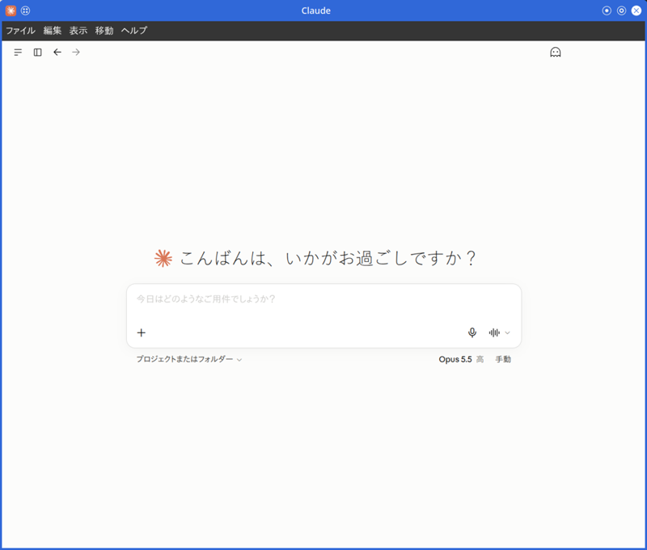
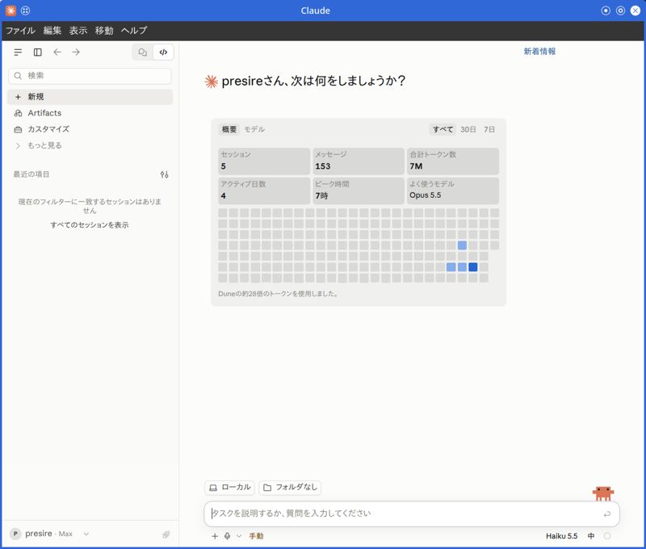

# Claude Desktop for openSUSE/SUSE Linux Enterprise

[](README.md#license)
[](README.md#distribution-support)
[](docs/BUILDING.md)

このプロジェクトは、Claude DesktopをopenSUSEおよびSUSE Linux Enterpriseでネイティブに実行するためのビルドスクリプトを提供します。  
公式のWindowsアプリケーションを再パッケージし、.rpmパッケージおよびAppImageを生成します。  

[aaddrick/claude-desktop-debian](https://github.com/aaddrick/claude-desktop-debian)のフォークで、openSUSE/SLEディストリビューション向けに適応されています。  

> [!NOTE]  
> これは非公式のビルドスクリプトです。  
> 公式サポートについては、[Anthropicのウェブサイト](https://www.anthropic.com)をご覧ください。  
> ビルドスクリプトやLinux実装に関する問題については、このリポジトリで[issueを開いて](https://github.com/presire/claude-desktop-suse/issues)ください。  

## 機能

| 機能 | 説明 |
|:---|:---|
| ネイティブLinuxサポート | 仮想化やWineを使用せずにClaude Desktopを実行できる。 |
| アプリケーション内トップバー | WCOシムにより、ハンバーガーメニュー、サイドバートグル、検索、ナビゲーションを提供する。(hybridモード) |
| タイトルバースタイル | hybrid(デフォルト：OSフレーム + アプリケーション内トップバー)、ネイティブ、hiddenの3モードを選択できる。 |
| ウィンドウアイコン | Claudeロゴをウィンドウアイコンに設定する。<br>X11のウィンドウマネージャ (KWin等) が、Electron既定のアトム型アイコンではなくアプリケーションアイコンをタイトルバー、`[Alt] + [Tab]`、タスクバーに描画する。 |
| 閉じてトレイに格納 | ウィンドウを閉じるとトレイに隠れ、MCPサーバやスケジューラを維持する。<br>逆の動作を望む場合は、`CLAUDE_QUIT_ON_CLOSE=1`でアプリケーションを明示的に終了できる。 |
| スタートアップ起動 | [起動時に実行]設定トグルをXDG自動起動に連携する。 |
| インプレースアップグレード検知 | 起動中に`zypper up`が`app.asar`を置き換えた場合、[クリックして再起動]通知を表示する。<br>新旧バージョンの画面と本体が混在して誤動作するのを防ぐ。 |
| KDE Plasma Waylandランチャーグルーピング | パッケージされた`app.asar`内にpkg.desktopNameを設定し、KDE PlasmaがClaude Desktopのウィンドウをインストール済みの.desktopファイルと同じグループにまとめる。(Waylandのタスクバーで分離表示される問題を修正) |
| トレイアイコンのテーマ切替 | nativeThemeの更新時に、トレーリングエッジ方式の再構築ミューテックスと、アイコンおよびコンテキストメニューをインプレースで更新する高速パスを使う。<br>起動時にダークテーマ用アイコンが黒いまま固着する問題と、KDE Plasmaの重複SNI登録レースを回避する。 |
| MCP (Model Context Protocol) サポート | MCPを完全に統合する。<br>設定画面で削除したサーバは削除されたまま保持され、設定の読み込みに失敗してもmcpServersは失われない。<br>`claude_desktop_config.json`を手動で編集する場合は、アプリケーションを終了してから行う。<br><br>設定ファイルの場所: `~/.config/Claude/claude_desktop_config.json` |
| Coworkモード | プラガブルな分離バックエンド (bubblewrap / host)と自動検出、クールダウン付きのデーモン自動再起動、ホストとサンドボックスで異なるパスをマウントする{src, dst}形式に対応する。<br><br>Claude Desktop 1.13576以降のCowork VM関連コードの変更に合わせて、Linux向けパッチを作成し直している。 |
| 診断機能 | `claude-desktop --doctor`による包括的なヘルスチェックを実行する。<br>ディスプレイサーバ、サンドボックス権限、MCP設定、残留ロック、IBus/GTK入力メソッド経路、Coworkバックエンドの状態、キーリング / パスワードストア検出、AppArmorのユーザ名前空間プロファイル、暗号化ホームのNAME_MAX、直近のElectronクラッシュ履歴を確認する。 |
| グローバルホットキー | `[Ctrl] + [Alt] + [Space]`で呼び出せる。<br>X11およびWayland (XWayland経由) で動作し、ネイティブWaylandではXDG GlobalShortcutsポータルを使用する。(`CLAUDE_USE_WAYLAND=1`) |
| システムトレイ統合 | ウィンドウを閉じても、トレイに常駐する。 |
| デスクトップ環境統合 | デスクトップ環境との統合を提供する。 |
| Quick Windowのフォーカス喪失 / 表示状態パッチ | KDE限定で適用し、GNOMEでの回帰を回避する。 |
| キーリング自動検出 | --password-storeによりkwallet6 / gnome-libsecretを検出する。<br>ElectronのsafeStorageが利用できなかったKDE Plasma等のデスクトップで、セッション永続化を修正する。 |
| GPUクラッシュ自動復旧 | 前回起動がChromium GPU FATALで終了していた場合、次回起動時に安全なGPUフラグを自動適用する。(`CLAUDE_DISABLE_GPU=0`で上書き可能) |
| AppStreamメタ情報 | GNOME Software / KDE Discoverにパッケージ名、概要、アイコン、ブランド情報を表示する。 |
| 終了時のヘルパープロセス整理 | 明示的に終了した時にヘルパープロセスをクリーンアップして、Desktop所有のCowork、Claude設定、拡張ヘルパーが取り残されないようにする。 |
| 起動時のヘルパー回収 | コマンドライン引数の形で判定する。(`cowork-vm-service.js`を名前に含むだけのエディタや`tail -f`は終了させない)<br>拡張機能サーバは過去の起動で生成されたものだけを回収して、途中で再利用されたPIDにはSIGKILLを送らない。<br>`SingletonLock`はPIDが終了している場合のみ除去する。 |
| ログの重複排除と上限 | `launcher.log`へのElectron出力を重複圧縮して、1セッションあたりの上限を設定する。(ELECTRON_LOG_CAP_BYTES、デフォルト20[MiB]) |
| AppImageのランタイム | 静的リンクのtype2ランタイムと、SHA-256で固定したビルドツールで生成する。<br>libfuse2パッケージは不要。 |
| Electron 45ベース | Windowsパッケージに同梱されるものと同じElectron 45でビルドする。<br>ネイティブWaylandでは、AppImageが非表示のデスクトップエントリを書き、xdg-desktop-portal 1.20以降でもGlobalShortcutsポータルのアプリID登録が通るようにする。 |
| ウィンドウ周りの互換性 | `[F11]`キーでフルスクリーンを切り替える。<br>メニューバーは、`[Alt]`キーを離した時のみ反応するため、`[Alt] + [Shift]`や`[Alt] + [F4]`で誤って切り替わらない。<br>上流のtitleBarStyle移行後もGNOME/X11でAboutウィンドウを描画できる。<br>X11のスロッピーフォーカス環境では、マウスを重ねただけでウィンドウが前面に出る動作を抑制する。 |

### スクリーンショット

<p align="center">
  
</p>

<p align="center">
  
</p>

<p align="center">
  
</p>

## インストール

### ソースコードからのビルド

詳細なビルド手順、技術的な詳細、手動アップデート方法については、[docs/BUILDING_JP.md](docs/BUILDING_JP.md)を参照してください。  

#### 前提条件

ビルド前に必要なパッケージをインストールしてください:  

```bash
sudo zypper install git gcc-c++ make
```

> [!WARNING]  
> ビルドでは既定でビルドツールとして`python3`の有無を確認して、SUSEでは不足している依存関係を`zypper`で自動インストールします。  
> 
> `node-pty`のコンパイルにPythonは使用しません。  
> ターミナル機能はプリビルドのLinuxバイナリから配置します。  
> 
> 対象アーキテクチャに適したネイティブバイナリがない場合、ターミナル機能なしのパッケージを作成せず、ビルドは失敗します。  
> 詳細は、[docs/BUILDING_JP.md](docs/BUILDING_JP.md)を参照してください。  

#### ビルドとインストール

```bash
# リポジトリのクローン
git clone https://github.com/presire/claude-desktop-suse.git
cd claude-desktop-suse

# RPMパッケージのビルド (デフォルト)
./build.sh

# AppImageのビルド
./build.sh --build appimage

# ダークモードトレイアイコンでビルド (暗いパネル向けの白アイコン)
./build.sh --dark

# パッケージのインストール
sudo zypper install ./claude-desktop-VERSION-ARCHITECTURE.rpm
```

ビルドスクリプトが残りの依存関係 (p7zip, wget, icoutils, ImageMagick, rpm-build) を`zypper`経由で自動インストールします。  
Node.jsの要件とビルド時の用意方法については、[Node.jsとasar](docs/BUILDING.md#nodejs-and-asar)を参照してください。  

### ビルド済みリリースの利用

[リリースページ](https://github.com/presire/claude-desktop-suse/releases)から最新の.rpmまたは.AppImageをダウンロードできます。  

#### RPM署名鍵のインポート

リリースの.rpmパッケージには、GPG署名が付いています。  
公開鍵を一度インポートすれば、以降は`zypper`がインストール時に署名を自動で検証します。  
(署名警告も表示されなくなります)  

| 項目 | 値 |
|:---|:---|
| 鍵ファイル | [`gpg/RPM-GPG-KEY-Claude-Desktop-SUSE`](gpg/RPM-GPG-KEY-Claude-Desktop-SUSE)<br>(リポジトリの`gpg/`ディレクトリ。各リリースにも添付) |
| UID | claude-desktop-suse &lt;presire@users.noreply.github.com&gt; |
| 指紋 | E699 6FE7 DC7A 9D08 5F8F 7D20 DA09 CAFB 07FA EC11 |

```bash
# 1. 公開鍵をダウンロード
curl -LO https://raw.githubusercontent.com/presire/claude-desktop-suse/main/gpg/RPM-GPG-KEY-Claude-Desktop-SUSE

# 2. 指紋が上表と一致することを確認
gpg --show-keys RPM-GPG-KEY-Claude-Desktop-SUSE

# 3. RPMデータベースへ公開鍵をインポート (初回のみ)
sudo rpm --import RPM-GPG-KEY-Claude-Desktop-SUSE

# 4. パッケージの署名を確認 (任意。"digests signatures OK"と表示されれば正常)
rpm -K ./claude-desktop-*.rpm

# 5. インストール
sudo zypper install ./claude-desktop-*.rpm
```

チェックサムで照合する場合は、先に`SHA256SUMS.txt`の署名を検証します。  

```bash
gpg --import RPM-GPG-KEY-Claude-Desktop-SUSE
gpg --verify SHA256SUMS.txt.asc SHA256SUMS.txt
sha256sum -c --ignore-missing SHA256SUMS.txt
```

公開鍵を削除する場合: `sudo rpm -e gpg-pubkey-07faec11`  

<br>

## 設定

Model Context Protocolの設定は以下に保存されます:  

```
~/.config/Claude/claude_desktop_config.json
```

環境変数、Waylandサポート、Coworkサンドボックスマウント等の追加設定については[docs/CONFIGURATION.md](docs/CONFIGURATION.md)を参照してください。  

<br>

## トラブルシューティング

`claude-desktop --doctor`コマンドを実行すると、よくある問題を自動診断できます。  
(ディスプレイサーバ、サンドボックス権限、MCP設定、残留ロック等)  
Coworkモードの準備状況 - 使用されるバックエンドと、不足している依存関係も確認できます。  

追加のトラブルシューティング、アンインストール手順、ログの場所については、[docs/TROUBLESHOOTING.md](docs/TROUBLESHOOTING.md)を参照してください。  

<br>

## ディストリビューションサポート

### テスト済みディストリビューション

- openSUSE Leap 16以降
- openSUSE Tumbleweed
- SUSE Linux Enterprise 16以降

<br>

## 謝辞

このフォークは、[aaddrick/claude-desktop-debian](https://github.com/aaddrick/claude-desktop-debian)をベースにしています。  

元のプロジェクトは、[k3d3のclaude-desktop-linux-flake](https://github.com/k3d3/claude-desktop-linux-flake)と、LinuxでClaude Desktopをネイティブに実行することについての[Reddit投稿](https://www.reddit.com/r/ClaudeAI/comments/1hgsmpq/i_successfully_ran_claude_desktop_natively_on/)にインスパイアされました。  

特別な感謝:  

- **aaddrick** - 元のDebianビルドスクリプト
- **k3d3** - 元のNixOS実装とネイティブバインディングの洞察
- **[emsi](https://github.com/emsi/claude-desktop)** - タイトルバー修正と代替実装アプローチ
- **[leobuskin](https://github.com/leobuskin/unofficial-claude-desktop-linux)** - PlaywrightベースのURL解決アプローチ
- **[yarikoptic](https://github.com/yarikoptic)** - codespellサポートとshellcheck準拠
- **[IamGianluca](https://github.com/IamGianluca)** - ビルド依存関係チェックの改善
- **[ing03201](https://github.com/ing03201)** - IBus/Fcitx5入力メソッドサポート
- **[ajescudero](https://github.com/ajescudero)** - Node互換性のための@electron/asarピン留め
- **[delorenj](https://github.com/delorenj)** - Wayland互換性サポート
- **[Regen-forest](https://github.com/Regen-forest)** - Gear LeverをAppImageLauncher代替として提案
- **[niekvugteveen](https://github.com/niekvugteveen)** - Debianパッケージング権限の修正
- **[speleoalex](https://github.com/speleoalex)** - ネイティブウィンドウ装飾サポート
- **[imaginalnika](https://github.com/imaginalnika)** - ログを`~/.cache/`へ移動
- **[richardspicer](https://github.com/richardspicer)** - Linux上のメニューバー表示修正
- **[jacobfrantz1](https://github.com/jacobfrantz1)** - Claude Desktopコードプレビューサポートとクイックウィンドウ送信修正
- **[janfrederik](https://github.com/janfrederik)** - ローカルインストーラを使用するための--exeフラグ
- **[MrEdwards007](https://github.com/MrEdwards007)** - OAuthトークンキャッシュ修正の発見
- **[lizthegrey](https://github.com/lizthegrey)** - バージョン更新への貢献
- **[mathys-lopinto](https://github.com/mathys-lopinto)** - AURパッケージと自動デプロイ
- **[pkuijpers](https://github.com/pkuijpers)** - RPMリポジトリGPG署名問題の根本原因分析
- **[dlepold](https://github.com/dlepold)** - トレイアイコン変数名バグの特定と修正
- **[Voork1144](https://github.com/Voork1144)** - トレイアイコンミニファイアバグの詳細分析、Chromiumレイアウトキャッシュバグの根本原因分析、直接の子ビューのサイズを変更する修正アプローチ
- **[sabiut](https://github.com/sabiut)** - --doctor診断コマンド、ダウンロード用SHA-256チェックサム検証、deb/rpm/AppImageアーティファクトのビルド後統合テスト
- **[milog1994](https://github.com/milog1994)** - ポップアップ検出、機能スタブ、Waylandコンポジタサポートを含むLinux UX改善
- **[jarrodcolburn](https://github.com/jarrodcolburn)** - コンテナ/CI環境でのパスワードレスsudoサポート、gh-pages 4GB肥大化修正の特定、Debianでのvirtiofsdパス検出問題の特定、CIリリースパイプライン障害の詳細分析、session-startフックのsudoブロッキング問題の診断
- **[chukfinley](https://github.com/chukfinley)** - LinuxでのCoworkモードサポート
- **[CyPack](https://github.com/CyPack)** - 起動時の孤立したcoworkデーモンクリーンアップ
- **[IliyaBrook](https://github.com/IliyaBrook)** - Claude Desktop >= 1.1.3541 arm64リファクタのプラットフォームパッチ修正
- **[MichaelMKenny](https://github.com/MichaelMKenny)** - $プレフィックス付きelectron変数バグの診断と回避策
- **[daa25209](https://github.com/daa25209)** - coworkプラットフォームゲートクラッシュの詳細な根本原因分析とパッチスクリプト
- **[noctuum](https://github.com/noctuum)** - 設定可能なメニューバー表示とブール別名サポート付きCLAUDE_MENU_BAR環境変数
- **[typedrat](https://github.com/typedrat)** - build.sh、node-ptyのビルド定義、CI自動更新を統合したNixOSフレーク、フレークパッケージスコーピングリグレッションの修正
- **[cbonnissent](https://github.com/cbonnissent)** - Cowork VMゲストRPCプロトコルのリバースエンジニアリング、KVM起動ブロッカーの修正、永続接続向けRPCレスポンスIDエコーイングの修正、専用Linux設定ファイルによる設定可能なbwrapマウントポイント
- **[joekale-pp](https://github.com/joekale-pp)** - RPMランチャーへの--doctorサポート追加
- **[ecrevisseMiroir](https://github.com/ecrevisseMiroir)** - tmpfsベースの最小ルートを使用したbwrapバックエンドサンドボックス分離
- **[arauhala](https://github.com/arauhala)** - NixOSのisPackagedリグレッションの詳細な根本原因分析
- **[cromagnone](https://github.com/cromagnone)** - 初期トリアージを覆す詳細なログによるbwrapインストール上のVMダウンロードループ確認
- **[aHk-coder](https://github.com/aHk-coder)** - cowork smol-binパッチでのハードコード化されたミニファイ変数クラッシュの診断
- **[RayCharlizard](https://github.com/RayCharlizard)** - 自己参照`.mcpb-cache`シンボリックリンクのELOOPバグの詳細分析、HostBackendでの自動メモリパス変換の修正
- **[reinthal](https://github.com/reinthal)** - nixpkgsのnodePackages削除によるNixOSビルドブレークの修正
- **[gianluca-peri](https://github.com/gianluca-peri)** - GNOMEの終了アクセシビリティ問題の報告とAppIndicatorでのトレイ動作の確認
- **[martin152](https://github.com/martin152)** - ランチャークリーンアップの3つのバグの詳細診断と完全なパッチ
- **[hfyeh](https://github.com/hfyeh)** - Ubuntu 24.04 AppArmor非特権ユーザ名前空間ブロックのCowork bwrapでの診断とAppArmorプロファイル回避策の提供
- **[davidamacey](https://github.com/davidamacey)** - リモートデスクトップセッションでのXRDP GPU合成による白画面問題の特定と修正
- **[pb3ck](https://github.com/pb3ck)** - CoworkのCLAUDE_CODE_OAUTH_TOKEN環境変数ストリップバグの診断
- **[aJV99](https://github.com/aJV99)** - ネイティブWaylandモードでのGDK_BACKEND=waylandエクスポートによるHiDPIディスプレイでのXWaylandフォールバックぼやけの修正
- **[Andrej730](https://github.com/Andrej730)** - quick-window正規表現の可読性改善 (生文字列リテラル + 正規表現エスケープ用ヘルパー) と、Claude Desktop 1.3883.0における表示状態判定関数の正規表現の破綻修正
- **[Joost-Maker](https://github.com/Joost-Maker)** - Claude Desktop 1.3109.0でのcowork Patch 9における$eのfs参照クラッシュの修正 ([$\\w]+識別子捕捉パターンの導入)
- **[HumboldtJoker](https://github.com/HumboldtJoker)** - Claude Desktop 1.5354.0におけるcowork Patch 2bのサイレント失敗の診断 (ログ行はパッチされていたが、セッション初期化が依然としてSwiftアドオン経由でルーティングされていたことを特定)
- **[zabka](https://github.com/zabka)** - Linuxで`cowork-vm-service.js`が自動起動されていなかった問題の特定と、systemdユニットによる回避策の提供 (デーモン自動起動修正のスコープ確定)
- **[sirfaber](https://github.com/sirfaber)** - Claude Desktop 1.5354.0におけるcowork Patch 2b (vmモジュール代入) とPatch 6のステップ2 (リトライ遅延の自動起動) の$を含む難読化識別子による破綻の修正
- **[ProfFlow](https://github.com/ProfFlow)** - RPM repodata署名のリグレッション再修正 (`gpg --default-key`に渡す鍵IDに!を付与し、`repomd.xml`を主鍵で署名するよう強制)
- **[jslatten](https://github.com/jslatten)** - パッケージされた`app.asar`の`package.json`にpkg.desktopNameを設定することで、KDE Plasma Waylandのランチャーグルーピングバグを修正
- **[Hayao0819](https://github.com/Hayao0819)** - 上流のtitleBarStyle:"" → titleBarStyle:"hiddenInset"移行によりGNOME/X11のAboutウィンドウの描画が壊れた原因の診断と、ポップアップウィンドウ判定の拡張の提供
- **[phelps-matthew](https://github.com/phelps-matthew)** - Linuxでトレイへの格納をハードコードする同梱ハンドラに頼らず、CLAUDE_QUIT_ON_CLOSE=1でアプリを明示的に終了するよう修正
- **[dubreal](https://github.com/dubreal)** - 起動時にD-Busでkwallet6 / gnome-libsecretを検出する--password-storeキーリング検出により、ElectronのsafeStorageが利用できなかったKDE Plasma等のデスクトップでセッション永続化を修正
- **[JustinJLeopard](https://github.com/JustinJLeopard)** - Node 24のextract-zipが何もせずに終了した後のElectronバイナリ欠落を検出し、@electron/getキャッシュから復旧する`unzip`フォールバックを追加。  
  さらにGNOME Software、KDE Discover、App Centerにパッケージを表示するAppStreamメタ情報を提供
- **[tkrag](https://github.com/tkrag)** - スロッピーフォーカス / フォーカス追従型のWM下で、X11ウィンドウがマウスを重ねただけで前面に出るバグの診断と修正
- **[maplefater](https://github.com/maplefater)** - 上流がログ呼び出しをカンマ式に畳み込んだ後、信頼済みフォルダ追加処理の.asarガードをメソッド宣言へ再アンカー
- **[MitchSchwartz](https://github.com/MitchSchwartz)** - 2つ目の`app.asar`ファイルドロップ経路 (2つ目のインスタンスの引数収集処理のファイル存在確認の分岐) を発見し、そこで.asarパスを拒否することで、タスクバーから再表示するたびにアプリ自身のバンドル添付を求められないよう修正
- **[LiukScot](https://github.com/LiukScot)** - トレイ再構築用ミューテックスをトレーリングエッジ方式にして起動時のダークテーマアイコンが黒で固着しないようにし、上流がコンテキストメニューの接続方法を構築済みメニューオブジェクトに変更した後のトレイアイコンをインプレースで更新する高速パスを復元
- **[jerem](https://github.com/jerem)** - ネイティブWaylandでQuick EntryのグローバルショートカットをXDG GlobalShortcutsポータル経由にし、すべてのChromiumの機能指定を単一の--enable-features=スイッチに統合
- **[caidejager](https://github.com/caidejager)** - 制限の厳しいumask下でビルドされたパッケージでCowork VMデーモンが自動起動しなかった原因を診断し、debとAppImageのインストール権限を正規化
- **[DhanushSantosh](https://github.com/DhanushSantosh)** - ランチャーログ内の前回GPUプロセスのFATALを検出し、次回起動時に安全なGPUフラグで自動再起動するGPUクラッシュ自動復旧
- **[emandel82](https://github.com/emandel82)** - 「Attach app.asar?」プロンプトの根本原因を特定。  
  すべてのランチャーが`app.asar`を冗長なElectron引数として渡し、2つ目のインスタンスの引数収集処理がそれを開くファイルとして扱っていた問題を修正
- **[svankirk](https://github.com/svankirk)** - 明示的な終了後にDesktopヘルパープロセスをクリーンアップ。  
  シグナル転送付き終了ラッパーとバンドル単位でUIの生存を確認する処理により、アプリ終了後にヘルパープロセスが残らないよう修正
- **[pjordanandrsn](https://github.com/pjordanandrsn)** - 上流の"yukonSilver" VMリファクタ (1.13576+) に合わせてcowork Linux向けパッチ群を再導出し、VM起動処理のyukonSilver.statusチェックにプラットフォーム判定を再アンカー
- **[chrisw1005](https://github.com/chrisw1005)** - Claude Desktop 1.13576+のLinux起動ハングの根本原因 (@ant/claude-nativeへのWindowsレジストリ / 権限昇格種別のエンタープライズポリシー呼び出しが無条件に行われること) を特定し、完全なWindows専用ネイティブスタブの修正を提供
- **[colonelpanic8](https://github.com/colonelpanic8)** - 同じClaude Desktop 1.13576+起動ハングを独立に再現し、Linux向けネイティブスタブのBATSテストを提供

NixOSユーザの方は、Nix固有の実装について[k3d3のリポジトリ](https://github.com/k3d3/claude-desktop-linux-flake)を参照してください。  

<br>

## ライセンス

このリポジトリのビルドスクリプトは、以下のデュアルライセンスの下でライセンスされています:  

- MITライセンス ([LICENSE-MIT](LICENSE-MIT)を参照)
- Apache License 2.0 ([LICENSE-APACHE](LICENSE-APACHE)を参照)

Claude Desktopアプリケーション自体は、[Anthropicの消費者向け利用規約](https://www.anthropic.com/legal/consumer-terms)の対象となります。  

<br>

## 貢献

貢献を歓迎します！  
貢献を提出することにより、このプロジェクトと同じデュアルライセンス条件の下でライセンスすることに同意したものとみなされます。  

元のDebianビルドスクリプトに関連する貢献については、[上流のリポジトリ](https://github.com/aaddrick/claude-desktop-debian)への貢献もご検討ください。  
